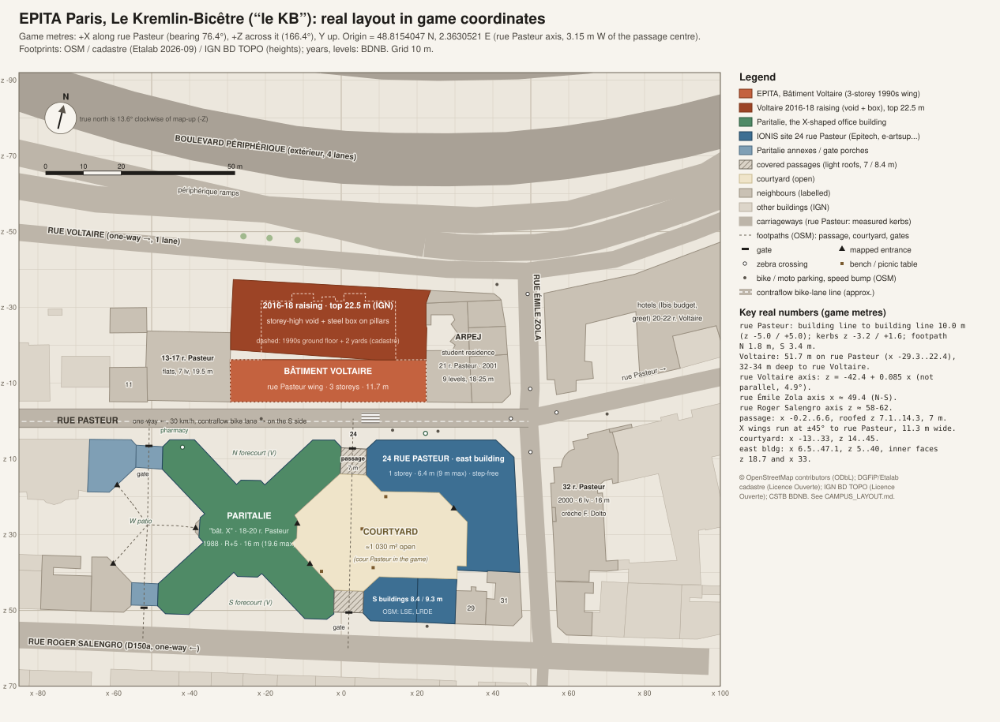

# Campus layout

The game takes place on EPITA's campus in Le Kremlin-Bicêtre, known to students as "le KB". The level is
built on the real building footprints, street axes and heights, taken from public map data and converted to
game metres. This document describes that data, the coordinate frame, the outlines the level is built on,
where they live in the code, and where the level departs from the real site.



The figure [`campus_layout.svg`](campus_layout.svg) shows the surveyed footprints on a 10 m grid, at 4.8
pixels per metre.

Related documents: [PIPELINE.md](PIPELINE.md) for how the level is built and imported,
[DESIGN.md](DESIGN.md) §6 for the in-game map, [ART_DIRECTION.md](ART_DIRECTION.md) for materials and
light.

---

## 0. Summary

The campus is three neighbouring sites on either side of rue Pasteur: KB1 (the Bâtiment Voltaire) to the
north, and to the south the X-shaped Paritalie building and 24 rue Pasteur, whose covered passage leads into
a courtyard and out through a second gate to rue Roger Salengro.

Game +X runs along rue Pasteur, which bears 76.4°, so the map is turned 13.6° from true north. One game
unit is one metre and the ground is flat. Building outlines come from the French cadastre and
OpenStreetMap, heights from IGN BD TOPO, storey counts and construction years from the national building
database. Positions are good to about 1 m and heights to about 2 m.

The outlines are stored once, in `tools/blender/campus_layout.py`, `campus_kb1.py` and
`campus_backdrop_data.py`. The level build (`tools/blender/build_campus.py`) extrudes them, and the map
export (`tools/map/export_plan.py`) writes the same footprints to `assets/levels/campus_plan.json` for the
in-game map. Section 4 lists what the level simplifies.

---

## 1. Sources and method

| Source | Used for | Licence |
|---|---|---|
| [OpenStreetMap](https://www.openstreetmap.org/copyright) | Building outlines, street centrelines, one-way directions, speed limits, cycle lanes, gates, entrances, crossings, street furniture | ODbL 1.0, © OpenStreetMap contributors |
| [Cadastre](https://cadastre.data.gouv.fr/) (DGFiP, distributed by Etalab), commune 94043, section A | Building footprints, hard and light construction, parcel boundaries | Licence Ouverte 2.0 |
| [IGN BD TOPO](https://geoservices.ign.fr/bdtopo) v3 | Building heights, roof and ground altitudes, road altitudes | Licence Ouverte 2.0 |
| IGN orthophoto | Checking outlines, roofs and tree positions from above | Licence Ouverte 2.0 |
| [BDNB](https://bdnb.io/) (CSTB) | Year built and number of levels per building | Licence Ouverte 2.0 |
| Base Adresse Nationale, SIRENE | Street numbers and which organisations sit at which address | Licence Ouverte 2.0 |
| [Panoramax](https://panoramax.fr/) street-level photos | Facades, signs, parking, kerbs and anything else only visible from the street | etalab-2.0 for the photos consulted |
| Tragin Architectes, "Surélévation KB" project text | The 2016–18 raising of KB1 | Reference only |

Only geometry derived from OpenStreetMap, the cadastre and IGN is stored in the repository. The other
sources were read for facts such as storey counts and are not redistributed. The attribution appears in the
corner of the in-game map sheet, in the credits and in the [README](../README.md).

The method is the same for every outline. The polygon is downloaded in WGS84, converted with the transform
in section 2, rounded to 0.1 m and stored as a list of (x, z) points. Heights are attached from IGN. Each
outline is then compared with the orthophoto rotated into the game frame, and with street-level photos where
a facade or a roof line matters.

The three footprint sources are not independent. OpenStreetMap's building outlines here are a 2010 import of
the cadastre, and IGN draws its footprints on the cadastre too. They agree to within 0.1 m, except for KB1,
where OpenStreetMap still shows the whole block as one shape. The orthophoto and the street photos are the
independent checks.

IGN states a horizontal precision of 2.5 to 3 m. Heights are ±1.5 m for the KB1 raising, which IGN measured
by photogrammetry, and ±2.5 m elsewhere, where they are interpolated. Street centrelines and kerbs from
OpenStreetMap are good to about ±1 m.

---

## 2. From real coordinates to game coordinates

Godot uses X and Z for the ground plane and Y up. The level keeps X along rue Pasteur, because the street
is the spine of the playable area and a street-aligned frame keeps most walls parallel to an axis.

The rotation is θ = 13.607°, the length-weighted mean of the rue Pasteur centreline and the two street
facades that face each other across it. Game +X points to compass bearing 76.4° (east-north-east) and −Z to
346.4°, toward rue Voltaire. True north is 13.6° clockwise from −Z.

The origin (0, 0, 0) is WGS84 48.8154047 N, 2.3630521 E. It lies on the midline between the two building
lines of rue Pasteur, 3.15 m west of the centre of the passage at no. 24.

Y = 0 is ground level. IGN ground altitudes on the campus run from 59.6 to 61.5 m, a fall of about 1 m from
west to east, so the level is flat.

```
E      = (lon − 2.3630521) × 73 441.7      metres east of the origin
N      = (lat − 48.8154047) × 111 206.2    metres north of the origin
x_game =  E·cos θ + N·sin θ
z_game =  E·sin θ − N·cos θ                with cos θ = 0.971934 and sin θ = 0.235255
```

The two scale factors are the lengths of one degree of longitude and latitude on the WGS84 ellipsoid at
this latitude. With this transform the building lines of rue Pasteur fall at z = −5.0 (KB1 side) and
z = +5.0 (campus side).

In the engine, `WorldEnv.FRAME_BEARING` (`scripts/level/world_env.gd`) holds the 76.4° bearing.
`WorldEnv.sky_dir(azimuth, elevation)` turns a compass direction into a game-space vector, which is how the
sun and moon are placed, and `WorldEnv.bearing_of(dir)` goes the other way. The map draws its north arrow
13.6° clockwise of page-up.

---

## 3. The real campus

### 3.1 The three sites that make up "le KB"

| Site | Description |
|---|---|
| KB1, the Bâtiment Voltaire, 14-16 rue Voltaire, with a second entrance on rue Pasteur (no. 19) | EPITA's main building. A three-storey building from the 1990s, raised in 2016–18 by Tragin Architectes: a storey-high void holding a roof terrace, then a three-storey steel box on pillars that come down through the two old yards. The box is clad in blue ribbed steel toward rue Voltaire and wood-look panels toward the campus. The architect's text places a 300-seat amphitheatre in the raising. |
| Paritalie, the X-shaped building, 18-20 rue Pasteur | An office building from 1988 with six levels and an underground car park, shared by companies and the schools. Four wings meet at an octagonal core. |
| 24 rue Pasteur, through to rue Roger Salengro | A covered passage from the street, a courtyard, a one-storey building wrapping the courtyard on its north and east sides, and two two-storey buildings on rue Roger Salengro. The site is step-free. It is shared with Epitech and e-artsup. |

### 3.2 Streets (game coordinates)

| Street | Geometry | Traffic |
|---|---|---|
| rue Pasteur | Centreline z ≈ −0.6 from x −105 to 49.4, continuing west to avenue de Fontainebleau. East of the rue Émile Zola junction it bends about 12° north: (49.4, −0.7) → (56.8, −2.2) → (122, −16). Building lines at z −5.0 and +5.0. | One lane, one-way westbound, 30 km/h, with an eastbound contraflow cycle lane on the south side. Cars park along the south kerb only. |
| rue Voltaire | Axis z ≈ −42.4 + 0.0854·x for x −70 to 28, which is 4.9° off rue Pasteur. East of x 28 it curves: (49.0, −39.6) → (72.1, −42.7) → (112.9, −57.9). | One lane, one-way eastbound, 50 km/h, parking on the KB1 side, trees on the north verge. |
| Slip road and on-ramp | The slip road runs at street level on a bridge from (22.0, −46.8) to (−93.7, −72.7). The on-ramp passes under it along z ≈ −53 to −57, about 7 m lower. | Two lanes each. |
| Boulevard Périphérique | Outer carriageway axis z ≈ −69 (x 0 to 40), −73 (x −25), −80 (x −56), in a cutting 7 to 8 m below rue Voltaire. | No noise wall: the edge of the cutting is a concrete balustrade about 1 m high. |
| rue Émile Zola | Axis x ≈ 49.4, north to south: (49.0, −39.6) → (49.8, −8.5) → (49.4, −0.7) → (49.9, 8.2) → (52.7, 54.3) → (53.4, 62.0). Zebra crossings on all four arms of the rue Pasteur junction and one by rue Voltaire. | Residential, 30 km/h. |
| rue Roger Salengro | Axis z ≈ 57.3 (x −63) → 60.0 (x 2) → 62.0 (x 53), 2.3° off rue Pasteur. Campus-side building line at z ≈ 51 to 53.5. | One-way westbound, 30 km/h, with a one-way cycle track on each side. The campus-side track crosses the south gate's path at (1.9, 54.9). |

The only kerb positions in the data are two points at the crossing in front of no. 24, at z −3.2 and +1.6.
Street photos show a traffic lane, the cycle lane and parked cars side by side further west, so the
carriageway is wider than 4.8 m away from the crossing.

There is no Vélib' station on rue Pasteur. The nearest is on rue Roger Salengro, west of the campus.

### 3.3 Buildings (game coordinates)

Height is the IGN value; "max" is the highest roof point above the lowest ground point.

| Building | x range | z range | Footprint | Height | Levels | Notes |
|---|---|---|---|---|---|---|
| KB1, rue Pasteur wing | −29.3 … 22.4 | −16.2 … −5.0 | 574 m² | 11.7 m | 3 | 51.7 m long, 11.2 m deep. White render, two-storey glass bays, a projecting "KB1" portal. |
| KB1, 1990s north block (ground floor) | −21.1 … 14.4 | −31.6 … −16.2 | 1,151 m² with the wing | — | 3 | Three ground-floor bays reach z −32.8 to −33.7. Two yards beside it: west x −29.3…−21.1 (8.2 m) and east x 14.4…22.4 (8.0 m). |
| KB1 raising, 2016–18 (roof outline) | −29.2 … 23.6 | −37.4 (west) / −34.5 (east) … −16.1 | 967 m² | 22.5 m ±1.5 | 3 over a void | Covers the north block and both yards. On rue Voltaire it stands on white columns over the building's own planted forecourt. The parcel line runs (−29.3, −39.1) → (23.5, −34.5). |
| ARPEJ student residence, 21 rue Pasteur | 22.4 … 44.7 | −34.5 … −4.9 | 556 m² | 18.4–24.9 m | 9 | Built 2001. Fills the corner of rue Pasteur, rue Voltaire and rue Émile Zola. |
| 13-17 rue Pasteur | −51.2 … −29.2 | −23.8 … −5.1 | 394 m² | 19.5 m | 7 | Flats, built 2021. |
| 11 rue Pasteur | −61.1 … −51.1 | −14.2 … −5.0 | 90 m² | 16.6 m | 5 | Flats. |
| Paritalie (the X) | −48.4 … 0.0 | 4.9 … 52.4 | 1,312 m² | 16 m (max 19.6) | 6 | Four wings about 11.3 m wide at ±45° to rue Pasteur, long faces about 16 m, centre near (−24.4, 28.3). The two wing ends on rue Pasteur are lower than the wings. A pharmacy occupies the north-west wing end at x ≈ −42. |
| Paritalie north gate porch | −54.2 … −47.1 | 6.4 … 12.7 | 41 m² | 9.3 m | — | Light structure over the alley west of the X. Gate at (−50.7, 6.6), kept closed. |
| Paritalie west annex | −66.9 … −54.1 | 4.8 … 18.8 | 149 m² | 9.1 m | 3 | Offices. |
| Paritalie south gate porch | −55.4 … −48.2 | 42.7 … 48.8 | 41 m² | 14.6 m | — | Gate at (−52.0, 49.3). |
| 24 rue Pasteur, east building | 6.5 … 47.1 | 5.0 … 40.0 | 829 m² | 6.4 m (max 9.0) | 1 | An inverted L: a north arm along rue Pasteur, 13.6 m deep, and an east arm along rue Émile Zola. Courtyard faces at z 18.6–18.9 and x ≈ 33, joined by a diagonal from (25.8, 18.9) to (33.2, 26.6). Street corner cut from (40.8, 5.0) to (45.6, 9.6). Planted roof. |
| Passage, 24 rue Pasteur | 0.0 … 6.7 | roofed 7.1 … 14.3 | 46 m² | about 4 m clear | — | A light roof between the X's wing end and the east building, nothing built above. IGN gives 7 m, interpolated; height-limit signs on both piers read 4 m. An open recess about 11 m wide lies between the street line and the roof. Gate at (3.0, 7.2). |
| South passage | −1.9 … 5.9 | 44.6 … 50.6 | 44 m² | 8.4 m (max 11.3) | — | Light structure with a walkway at first-floor level. The gate is at the street end, (2.0, 50.5). |
| South building, west | 5.7 … 20.2 | 41.1 … 53.1 | 156 m² | 8.4 m | 2 | |
| South building, east | 19.8 … 30.5 | 41.4 … 53.5 | 120 m² | 9.3 m (max 10.1) | 2 | |
| 29 and 31 rue Roger Salengro | 30.0 … 47.7 | 39.5 … 54.0 | 72 + 117 m² | 12.8 / 17.2 m | 3 / 5 | Brick, built 1894 and 1900. |
| 32 rue Pasteur | 55.2 … 73.0 | 2.1 … 42.4 | 517 m² | 15.9 m (max 19.6) | 6 | East of rue Émile Zola, built 2000, a crèche on the ground floor. |
| Hotels, 20-22 rue Voltaire | 53.5 … 118 | −51 … −7 | 1,395 m² | 27.2 m | — | |

Beyond the périphérique, the long red barrel roofs belong to the RATP maintenance workshop of métro line 7.

### 3.4 Open spaces, paths and street furniture

The courtyard covers about 1,030 m², spanning x −13.1 to 33.2 and z 14.0 to 44.9.

A private path runs north to south through the site: from rue Pasteur through the gate at (3.0, 7.2) and
the passage, straight across the courtyard to the south passage at (2.1, 44.8), its gate at (2.0, 50.5), and
on to rue Roger Salengro at (1.8, 60.0). Gate to gate is 43 m.

The X leaves four open spaces between its wings. The north one is a tree-filled forecourt on rue Pasteur,
about 31 m wide at the street (x −38.7 to −7.5) and narrowing to a point at z ≈ 16. The east one is the
courtyard, whose inner corner is the short face at x ≈ −11.6, z 25.9 to 30.9. The south one opens on rue
Roger Salengro. The west one is the Paritalie patio, reached from the alley between the two gate porches.

OpenStreetMap maps three entrances onto the courtyard: one on the east building's diagonal corner at
(29.7, 23.0), and two on the X, at (−11.6, 27.0) on the inner corner face and at (−8.3, 37.6) on the
south-east wing. It also maps benches at (11.7, 20.0) and (−5.2, 39.7) and picnic tables at (5.5, 28.5) and
(8.4, 38.7).

On rue Pasteur the data gives a zebra crossing at x 7.7 in front of no. 24, one speed bump at x −21.1, bike
stands for ten at (13.6, 2.4), a motorcycle bay at (25.5, 2.7) and a fire hydrant at (40.3, 3.1). Street
trees stand on the south pavement and dark-brown bollards line it; the north kerb is painted yellow.

### 3.5 What students call things

| Name used in the game | Public evidence |
|---|---|
| "le KB" | Used for the campus in the French Wikipedia article on Epitech ("Campus « Le KB »"). |
| "KB1" | On the entrance signs of the Voltaire building, on both streets. |
| "KB 2,3,4" | On the banner at the passage, for the 24 rue Pasteur buildings. Which building carries which number is not shown. |
| "cour Pasteur" | On the same banner: "Campus Kremlin-Bicêtre, cour Pasteur". |
| "Paritalie", "the X" | Paritalie is the name the building goes by in postal addresses, in the building database and on its paths in OpenStreetMap. "The X" describes its shape. |
| "l'Under" | Event listings place it at 24 rue Pasteur, in the basement. Its extent and entrance are not in any dataset. |
| SM14, SM15, Amphi 4, the cafeteria | Not in public data. Their positions in the level are the game's own (section 4). |

---

## 4. The level compared with the real campus

The level follows the survey for everything a player on campus would recognise: the building footprints of
section 3.3, rue Pasteur's 10 m width, the passage and both gates, the courtyard outline, the angle of the
X's wings, the heights of the buildings, the neighbours on their real outlines, and rue Voltaire with the
slip road and the périphérique in its cutting behind it. The sun is the real one as well: the first time of
day uses azimuth 242.3° and elevation 11.5°, the sun's position at 17:42 on 15 October 2026.

The departures are listed below.

| Item | Real | Level |
|---|---|---|
| Ground | About 1 m of fall from west to east | Flat at y = 0. The périphérique sits at y = −7.5. |
| Playable extent | Open streets | Rue Pasteur is closed by invisible walls at x −48, past the X's north-west wing end, and x 46.5, on the rue Émile Zola kerb. Everything beyond is backdrop. |
| Rue Pasteur kerbs | Known only at the crossing (z −3.2 and +1.6) | Symmetric kerbs at z ±3.2, with the cycle-lane line at z −0.25 and cars parked along the south kerb. |
| KB1, 1990s building | 11.7 m | Roof at 11.25 m, parapet at 11.85 m. |
| KB1 raising | Top at 22.5 m ±1.5 | Soffit at 14.1 m, three storeys of 2.8 m, roof at 22.5 m, parapet at 22.95 m. |
| KB1 portal on rue Pasteur | Present; exact position along the facade not surveyed | At x 7.6 to 11.0. |
| Paritalie height | 16 m, 19.6 m at the highest point | Wings to 17.5 m (a 3.6 m ground floor and five storeys of 2.78 m), core penthouse to 19.6 m. |
| Paritalie wing ends on rue Pasteur | Lower than the wings; the north-west end has four or five storeys | North-east end four levels, north-west end five. |
| Passage roof | Light roof, about 4 m clear | Soffit at 4.2 m, blue fascia above it up to 6.1 m. |
| East building | 6.4 m, 9.0 m at the highest point | Walls to 6.4 m, a raised hall roof at 8.9 m. |
| Unnamed surrounding buildings | Individual heights | 132 outlines extruded as plain blocks. Height is chosen from footprint area with a seeded random storey count, since no height data is attached to them. |
| RATP workshop | Surveyed outlines not used | Sheds with red barrel roofs placed in the right area. |
| Ends of the long views | — | Rows of plain blocks close the view west along rue Pasteur and east past its bend. |
| Bike parking on rue Pasteur | Stands for ten bikes | A bike rack at the same place with two Vélib' bikes parked at it, and a motorcycle bay at x 25.5. |

Room positions are the game's own. Amphi 4 is in the north arm of the east building (x 9.65 to 27.85,
z 6.1 to 18.2), with its stage 2.4 m below the courtyard and seven tiers. The cafeteria is the ground floor
of the X's south-east wing, behind a glass front on the courtyard. The Under is a basement at y = −3.6 under
the two south buildings (x 2 to 28, z 39.5 to 52), reached by a ramp from the courtyard. SM14, SM15 and the
accueil lobby are in KB1's north block, the labs on the first floor.

---

## 5. Coordinates

All polygons are lists of (x, z) points in game metres. Footprints are walked clockwise in (x, z), so that
`campus_arch.wall_frame` puts the outside of each wall on the right. `tools/blender/campus_poly.py` holds
the polygon helpers (orientation, clipping, triangulation, grid cuts) and has no Blender dependency.

### 5.1 Real footprints for `campus_layout.py`

The south side of rue Pasteur is stored as polygons in `tools/blender/campus_layout.py`:

```python
X_PARITALIE = [(-45.2, 4.9), (-47.0, 6.7), (-47.2, 12.7), (-36.0, 24.5), (-37.2, 25.5), (-37.5, 30.7),
               (-36.3, 32.0), (-48.2, 42.9), (-48.4, 48.8), (-46.4, 50.9), (-40.2, 51.1), (-28.3, 39.9),
               (-27.3, 41.0), (-22.1, 41.2), (-20.9, 40.3), (-9.6, 52.1), (-3.8, 52.4), (-1.9, 50.9),
               (-1.8, 44.6), (-13.1, 32.3), (-11.7, 30.9), (-11.6, 25.9), (-12.3, 24.9), (-0.2, 13.9),
               (0.0, 7.1), (-1.7, 5.0), (-7.5, 5.0), (-20.2, 16.9), (-21.2, 15.7), (-26.4, 15.6),
               (-27.6, 16.7), (-38.7, 4.9)]
EAST_24 = [(9.2, 5.0), (6.7, 7.4), (6.5, 14.3), (10.5, 18.6), (25.8, 18.9), (33.2, 26.6), (33.0, 38.3),
           (30.6, 38.2), (30.6, 39.4), (47.1, 40.0), (45.6, 9.6), (40.8, 5.0)]
PASSAGE_N = [(0.0, 7.1), (-0.4, 14.0), (6.5, 14.3), (6.7, 7.4)]      # light roof, gate at (3.0, 7.2)
RECESS_N = [(-1.7, 5.0), (0.0, 7.1), (6.7, 7.4), (9.2, 5.0)]         # open recess in front of the roof
PASSAGE_S = [(-1.8, 44.6), (-1.9, 50.4), (5.7, 50.6), (5.9, 44.9)]   # light structure, gate at (2.0, 50.5)
SOUTH_W = [(5.9, 44.9), (5.7, 50.6), (7.7, 52.7), (19.8, 53.1), (20.2, 41.4), (10.0, 41.1)]   # 8.4 m
SOUTH_E = [(20.2, 41.4), (19.8, 53.1), (30.0, 53.5), (30.5, 41.7)]                            # 9.3 m
COURT = [(-0.4, 14.0), (-12.3, 24.9), (-11.6, 25.9), (-11.7, 30.9), (-13.1, 32.3), (-8.3, 37.6),
         (-1.8, 44.6), (5.9, 44.9), (10.0, 41.1), (20.2, 41.4), (30.5, 41.7), (30.6, 38.2), (33.0, 38.3),
         (33.2, 26.6), (29.7, 23.0), (25.8, 18.9), (10.5, 18.6), (6.5, 14.3)]                 # about 1,030 m2
```

KB1 has three surveyed outlines, referred to in the code as `VOLT_STRIP`, `VOLT_GF` and `VOLT_RAISE`:

```python
VOLT_STRIP = [(-29.3, -16.2), (-29.2, -5.1), (22.4, -5.0), (22.4, -16.1)]         # rue Pasteur wing
VOLT_GF = [(-29.3, -16.2), (-29.2, -5.0), (22.4, -5.0), (22.4, -16.2), (14.4, -16.1), (14.3, -31.7),
           (6.3, -31.6), (6.4, -33.6), (0.7, -33.7), (0.7, -31.7), (-1.5, -31.6), (-1.6, -32.8),
           (-5.0, -32.8), (-5.1, -31.6), (-7.3, -31.6), (-7.4, -33.6), (-13.0, -33.6), (-13.0, -31.6),
           (-21.1, -31.7), (-21.1, -16.2)]                                        # 1990s ground floor
VOLT_RAISE = [(-29.2, -16.1), (22.4, -16.1), (22.4, -31.1), (23.6, -34.5), (-28.5, -37.4)]   # box roof
```

`tools/blender/campus_kb1.py` builds on them through axis-aligned constants: the wing is `WX0, WX1` by
`WZS, WZN` (x −29.25 to 22.4, z −5.0 to −16.15), the north block is `NX0, NX1` to `NZN` (x −21.1 to 14.35,
to z −31.65), `BAYS_N` holds the three ground-floor bays, and `RAISE` is `VOLT_RAISE` itself. The south edge
of `VOLT_RAISE` is squared to z −16.1; in the raw IGN polygon that edge drifts by 2.7 m, which is within
IGN's stated precision.

Rue Pasteur's cross-section is in `tools/blender/campus_street.py`: `SIDE_N, SIDE_S = -5.0, 5.0` for the
building lines and `CURB_N, CURB_S = -3.2, 3.2` for the kerbs. The other street axes are polylines in
`tools/blender/campus_backdrop.py`:

```python
AXIS_PASTEUR_E = [(49.4, -0.7), (56.8, -2.2), (122.2, -16.4)]
AXIS_VOLTAIRE = [(-165.1, -64.2), (-152.7, -60.3), (-86.2, -49.9), (-69.2, -48.3), (28.0, -40.0),
                 (49.0, -39.6), (72.1, -42.7), (93.0, -50.0), (112.9, -57.9)]
ZOLA_N = [(49.4, -0.7), (49.8, -8.5), (49.2, -33.5), (49.0, -39.6)]
ZOLA_S = [(49.4, -0.7), (49.9, 8.2), (52.7, 54.3), (53.1, 58.4), (53.4, 62.0)]
AXIS_SALENGRO = [(-130.4, 54.9), (-118.8, 55.3), (-106.4, 55.7), (-63.0, 57.2), (-52.3, 57.7), (1.8, 60.0),
                 (53.4, 62.0), (61.3, 62.3), (97.0, 63.5)]
SLIP_ROAD = [(22.0, -46.8), (10.8, -48.8), (-0.6, -51.5), (-93.7, -72.7)]
ON_RAMP = [(-110.0, -66.0), (-64.5, -58.5), (10.5, -54.1), (35.6, -53.0), (60.2, -54.6), (96.3, -64.7)]
```

The same file holds the two carriageways of the périphérique (`PERIPH`, `PERIPH_IN`) and the gameplay walls
(`WALL_W, WALL_E = -48.0, 46.5`).

### 5.2 The map plan (`campus_plan.json`)

`python3 tools/map/export_plan.py` writes `assets/levels/campus_plan.json`. It imports `campus_layout.py`
as a plain module and reads the KB1 constants out of `campus_kb1.py` as text, because that file needs
Blender to import. The map and the level therefore draw from the same numbers.

| Key | Content |
|---|---|
| `bounds` | The mapped rectangle, `[-55, -50, 110, 115]` (x, z, width, depth) |
| `north_deg`, `carreau_m` | 13.6 and 4.0: the north arrow's angle and the size of one grid square in metres |
| `credit` | The attribution line drawn in the corner of the sheet |
| `buildings` | KB1, 24 rue Pasteur, Paritalie and the two south buildings, each with an id, a label, a hatch angle and its points |
| `covered` | The two passages |
| `court` | The courtyard polygon |
| `rooms` | Amphi 4, the cafeteria, the Under (dashed, as a basement), SM14 (first floor) and the accueil |
| `streets` | Rue Pasteur and rue Voltaire as straight bands with a one-way direction |
| `off_page`, `labels` | Arrows to places off the sheet, and free labels such as "cour Pasteur" |

The map is simpler than the level. KB1 is drawn as the wing and the north block without the bays or the
raising, rue Voltaire as a straight band from (−55, −44) to (55, −36), and the neighbouring buildings are
left out. `scripts/ui/map_view.gd` reads the file and `tests/test_map.gd` checks that it loads, that it
carries the attribution, and that no two labels overlap.

### 5.3 Backdrop footprints (`campus_backdrop_data.py`)

The buildings around the campus are read out of the figure itself. `python3.11 tools/py/backdrop_from_svg.py`
parses the polygons of `campus_layout.svg`, converts pixels back to game metres with
x = (px − 432) / 4.8 and z = (py − 533.6) / 4.8, and writes `tools/blender/campus_backdrop_data.py`. The
fill colour of a polygon decides where it goes: labelled neighbours and the Paritalie annexes become the 21
entries of `NAMED` (ARPEJ in five parts, 13-17 and 11 rue Pasteur, 32 rue Pasteur, the hotels, the gate
porches and others), matched by the centre of their bounding box, and the remaining IGN outlines become the
132 polygons of `OTHERS`. Outlines of the campus buildings are skipped, since the level models those itself.
The generated file is not edited by hand.

`campus_backdrop.py` builds the labelled neighbours with their own facades, at their IGN heights where the
survey has one, and the others as plain blocks. Parts named `far_*` cast no shadows (`assets/levels/campus_import.gd`).

---

## 6. Limits of the public data

Public data describes the outside of the campus. It does not say where rooms are, which of the 24 rue
Pasteur buildings is KB2, KB3 or KB4, or how far the Under extends below ground, so those parts of the level
are the game's own layout rather than a survey.

Three measured values carry more uncertainty than the rest. The kerbs of rue Pasteur are known at one
crossing only. The storey count of the X's north-west wing end is read from a single street photo. Heights
other than the KB1 raising are interpolated by IGN to ±2.5 m, which is close to one storey.

Open work on the level is tracked in [STATUS.md](STATUS.md).
